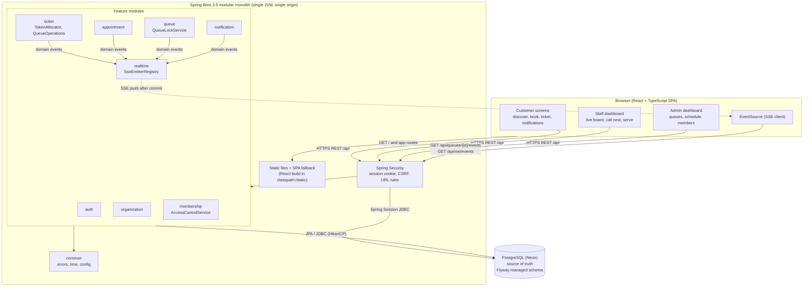

# Architecture

QueueLess is a **modular monolith**: one Spring Boot application, organized into business
modules, backed by one PostgreSQL database. The React frontend is compiled into the same
deployable and served from the same origin as the API.



Source: [`diagrams/01-system-architecture.mmd`](diagrams/01-system-architecture.mmd). All diagrams: [diagrams/README.md](diagrams/README.md).

## 1. Goals and constraints that shaped the design

| Driver | Consequence |
|---|---|
| Correctness under concurrency (tokens, slot capacity, one ticket at the counter) | PostgreSQL is the single source of truth; every queue write runs in a transaction that locks the queue row; database constraints back up every invariant. |
| Multi-tenant access control | Roles live in `organization_memberships`; every protected operation resolves the organization from the resource and checks the caller's role there. |
| Real-time updates without page refresh | Server-Sent Events, published only after commit, carrying only ids. |
| 1–2 week build by one student | No microservices, no broker, no cache layer; plain Spring MVC + JPA. |
| Zero-cost hosting (Render free: 0.1 CPU, 512 MB, sleeps when idle; Neon free) | Single container, single origin, small connection pool, liveness probe that never touches the database, JVM tuned for 512 MB, CDS for faster cold starts. |

## 2. Runtime components

| Component | Responsibility | Key classes |
|---|---|---|
| Static web | Serves `index.html`, hashed assets (cached for a year) and returns `index.html` for SPA routes such as `/tickets/123`. | `common.web.SpaWebConfig` |
| Security | Session cookie (`QUEUELESS_SESSION`, HTTP-only, SameSite=Lax, Secure in prod), CSRF double-submit cookie for the SPA, URL-level rules, JSON 401/403. | `auth.security.SecurityConfig` |
| auth | Registration, login, logout, "who am I", login/registration throttling. | `AuthController`, `AuthService`, `AttemptLimiter` |
| organization | Tenants and public discovery. | `OrganizationService` |
| membership | Organization roles, the permission matrix, member management, platform provisioning. | `AccessControlService`, `Permission`, `MembershipService` |
| queue | Queue configuration, open/pause/close, the per-queue row lock, SSE subscription endpoint. | `QueueService`, `QueueLockService`, `LockedQueue` |
| ticket | Token allocation, walk-ins, staff operations (call-next, start, complete, no-show, priority), positions and wait estimates. | `TicketService`, `QueueOperationsService`, `TokenAllocator`, `QueueReadService`, `WaitTimeEstimator` |
| appointment | Slot grid, booking with capacity and idempotency, check-in, cancellation. | `AppointmentService`, `BookingRules`, `SlotSchedule` |
| notification | Persistent in-app notifications and the personal event stream. | `NotificationService` |
| realtime | SSE connection registry, heartbeats, after-commit relay, transport abstraction. | `SseEmitterRegistry`, `RealtimeEventRelay`, `RealtimeGateway` |
| common | Error codes and problem details, clock, configuration, request ids. | `GlobalExceptionHandler`, `TimeProvider` |
| seed | Idempotent demo data (dev; opt-in in prod). | `DemoDataSeeder` |

### Layering inside a module

```
api/      controllers + request/response DTOs (validation at the boundary, no business rules)
service/  use cases, @Transactional boundaries, authorization calls, locking
domain/   JPA entities with state-changing methods that enforce invariants, repositories
```

Controllers never call repositories for operations that need transactional coordination;
JPA entities are never returned from controllers (DTOs only), which also prevents mass
assignment (clients cannot set status, token, role or organization fields).

### Module dependencies (no cycles)

```
common  <-  auth  <-  membership  <-  queue  <-  ticket  <-  appointment
   ^          ^           ^                         |
   |          |           +--- organization <-------+
   +-- realtime, notification (used by queue, ticket, appointment)
```

Two dependency inversions keep the graph acyclic:

- `auth.service.MembershipDirectory` (interface in auth) is implemented by the membership
  module, so `/api/auth/me` can list memberships although membership depends on auth.
- `ticket.service.TicketLifecycleListener` (interface in ticket) is implemented by
  `appointment.service.AppointmentTicketSync`, so a ticket status change updates its
  appointment in the same transaction without the ticket module knowing appointments exist.

Read-only projections may join tables owned by other modules (for example the staff board
joins `users` for display names); writes always go through the owning module.

## 3. Request flows

| Flow | Path through the system | Diagram |
|---|---|---|
| Book an appointment | AppointmentController → AppointmentService (lock queue, validate slot, count capacity, insert appointment, reserve token, notification, version bump) → commit → SSE | [booking](diagrams/03-appointment-booking-sequence.mmd) |
| Walk-in token | TicketController → TicketService (lock queue, one-active-ticket rule, `MAX+1`, insert) → commit → SSE | [tokens](diagrams/04-token-generation-sequence.mmd) |
| Call next | StaffQueueController → QueueOperationsService (authorize, lock, counter free?, first waiting in service order, CALLED, notifications) → commit → SSE | [call-next](diagrams/05-call-next-sequence.mmd) |
| Live update | any write → `QueueChangedEvent` → AFTER_COMMIT relay → SseEmitterRegistry → browser refetches | [live update](diagrams/06-live-update-sequence.mmd) |
| Read a ticket | QueueReadService in a read-only REPEATABLE READ transaction → position and estimate computed from one snapshot | — |

## 4. Why a modular monolith (summary of ADR 0001)

For the expected load (a few organizations, tens to hundreds of tickets per queue per day) a
single process is simpler to build, test, deploy and reason about: transactions span modules
for free (booking + token + notification commit atomically), there is no network between
components, and one free instance suffices. Module boundaries and the event abstraction keep
the code splittable later. A distributed architecture would become justified when one of these
is true: independent teams need independent deployments; one capability (e.g. notifications to
SMS/WhatsApp) needs very different scaling or availability; or sustained load exceeds what one
database-backed instance can serve even after vertical scaling and read replicas. See
[scalability-and-tradeoffs.md](scalability-and-tradeoffs.md).

## 5. Key trade-offs

| Decision | Benefit | Cost / limitation |
|---|---|---|
| Queue-row pessimistic lock for all writes to a queue | Simple, provably serial per queue; easy to explain; deadlock-free (one lock per transaction) | Throughput per queue limited by transaction length (milliseconds, ample here); a slow transaction delays that queue only |
| SSE instead of WebSockets | One-way push over plain HTTP, built-in browser reconnect, works through proxies | Server-to-client only; registry is per instance (see ADR 0005) |
| Events carry ids only; clients refetch | No private data on broadcast channels; lost/duplicated events are harmless | One extra GET per event per client |
| Sessions in PostgreSQL (Spring Session JDBC) | Logins survive restarts/redeploys/sleep on the free tier; instances become stateless | A session read/update per request (small, same region) |
| Server-computed positions/estimates | One authoritative calculation, consistent snapshot | Not pushed in events; computed on each read |
| Single origin (React served by Spring Boot) | No CORS, SameSite cookies just work, SSE same-origin | Frontend and backend deploy together |

## 6. Implemented vs tested vs future

- **Implemented and tested:** everything listed in the functional requirements; see
  [testing.md](testing.md) for the executed suites (unit, PostgreSQL integration, concurrency,
  Playwright E2E, smoke test against the production jar).
- **Implemented, verified manually only:** UI appearance and responsiveness (checked in a browser).
- **Future proposals (not implemented):** multi-instance event fan-out (PostgreSQL
  LISTEN/NOTIFY or Redis Pub/Sub), shared rate limiting, SMS/WhatsApp notifications, multiple
  counters per queue, audit log table. See [scalability-and-tradeoffs.md](scalability-and-tradeoffs.md).
