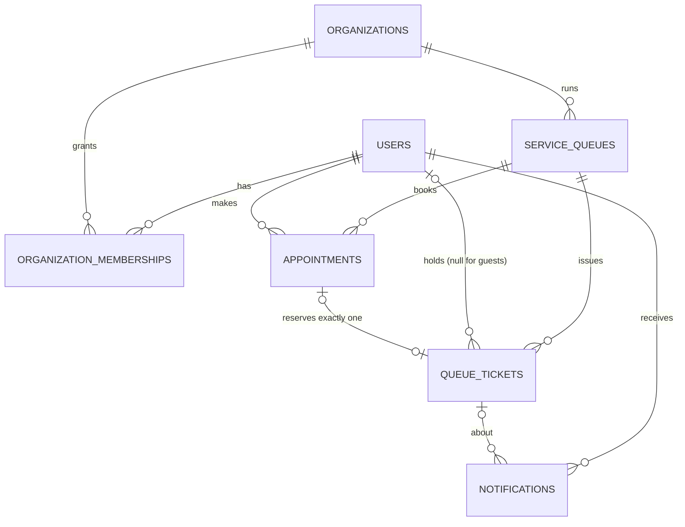

# Database design

PostgreSQL is the authoritative store for every piece of state: organizations, users, roles,
queues, appointments, tickets, notifications and HTTP sessions. Nothing authoritative lives
only in Java memory or the browser. The schema is created and evolved **only** by Flyway
migrations (`backend/src/main/resources/db/migration`); Hibernate runs with
`ddl-auto=validate`, so the application refuses to start if entities and schema disagree.

| Migration | Contents |
|---|---|
| `V1__identity_and_organizations.sql` | `users`, `organizations`, `organization_memberships` |
| `V2__queues_appointments_tickets.sql` | `service_queues`, `appointments`, `queue_tickets` |
| `V3__notifications.sql` | `notifications` |
| `V4__http_sessions.sql` | `spring_session`, `spring_session_attributes` (copied from Spring Session so Flyway owns every table) |

## Entity-relationship diagram



Full diagram with attributes: [`diagrams/02-entity-relationship.mmd`](diagrams/02-entity-relationship.mmd).

## Conventions

- **Primary keys:** `uuid`, generated by the application (JPA `GenerationType.UUID`) with a
  `gen_random_uuid()` default for hand-written SQL. UUIDs are unguessable, so ids in URLs do not
  reveal counts or invite enumeration.
- **Instants:** `timestamptz` (Java `Instant`), always UTC on the wire.
- **Organization-local calendar values:** `date` and `time` (Java `LocalDate`, `LocalTime`),
  stored verbatim and interpreted in `organizations.timezone`.
- **Enumerations:** `varchar` + `CHECK (... IN (...))`, mapped with `@Enumerated(STRING)`
  (readable in SQL, safe to reorder in Java).
- **Timestamps:** `created_at`/`updated_at` are set by the application from an injectable clock
  (tests control time), truncated to microseconds to match PostgreSQL precision.
- **Deletion:** business records are never deleted (cancellation is a status). Only memberships
  can be removed. Foreign keys use the default `NO ACTION`.

## Time-zone policy

| Concept | Stored as | Interpreted in |
|---|---|---|
| Opening/closing time | `time` | organization time zone |
| Appointment slot start | `timestamptz scheduled_at` | absolute instant; generated from local date + local slot time in the organization zone |
| Service date (token numbering day, "today") | `date service_date` | organization zone (`LocalDate.ofInstant(now, zone)`) |
| Every other timestamp | `timestamptz` | UTC |

An organization's time zone is fixed after creation (changing it would silently move existing
bookings). Daylight-saving transitions: a slot that falls into a DST gap is shifted forward by
`java.time`; this cannot occur for the demo zone (Asia/Kolkata has no DST) and is documented as a
known edge case.

**Lesson recorded in tests:** an early configuration set `hibernate.jdbc.time_zone=UTC`, which
made Hibernate shift `LocalTime` values by the JVM's offset (09:00 was stored as 03:30 on a
+05:30 machine). Round trips through Hibernate hid the bug; it surfaced only when a shifted
range crossed midnight and violated `ck_queues_hours`. The setting was removed and
`TimeZoneStorageIT` (run in an Asia/Kolkata JVM) now reads the raw values back with SQL.

## Tables

### users
| Column | Type | Notes |
|---|---|---|
| id | uuid PK | |
| email | varchar(254) | **unique**, `CHECK (email = lower(btrim(email)))` makes uniqueness case-insensitive |
| full_name | varchar(120) | |
| password_hash | varchar(100) | `{bcrypt}...` from Spring Security's delegating encoder; never returned by the API |
| enabled | boolean | disabled accounts cannot log in |
| platform_admin | boolean | may provision organizations; grants no access to organization data |
| created_at, updated_at | timestamptz | |

### organizations
`id`, `name`, **unique** `slug` (`CHECK slug ~ '^[a-z0-9]+(-[a-z0-9]+)*$'`), `description`,
`timezone` (IANA id, validated in Java), `active`, timestamps. Inactive organizations behave as
not found everywhere.

### organization_memberships
`id`, `organization_id` FK, `user_id` FK, `role` (`CUSTOMER`/`STAFF`/`ADMIN`), timestamps.
**`UNIQUE (user_id, organization_id)`**: one role per user per organization. A CUSTOMER
membership is inserted automatically (`INSERT ... ON CONFLICT DO NOTHING`) the first time a user
books or joins a queue of the organization; it never downgrades an existing STAFF/ADMIN role.

### service_queues
`id`, `organization_id` FK, `name` (**unique per organization**), `description`,
`token_prefix` (`^[A-Z]{1,5}$`), `status` (`OPEN`/`PAUSED`/`CLOSED`), `booking_enabled`,
`opening_time`, `closing_time` (`CHECK closing_time > opening_time`),
`slot_duration_minutes` (5–240), `capacity_per_slot` (1–100), `default_service_minutes` (1–240),
`state_version` (incremented on every live change), timestamps.

The queue row is also the **lock** that serializes all writes to that queue
(see [concurrency-and-transactions.md](concurrency-and-transactions.md)).

### appointments
| Column | Notes |
|---|---|
| queue_id, user_id | FKs |
| scheduled_at | slot start (instant) |
| service_date | organization-local date of `scheduled_at` (denormalized for the per-day rule) |
| booking_reference | **unique**, e.g. `QL-7K3M9X` (Crockford base-32) |
| status | `BOOKED`, `CHECKED_IN`, `COMPLETED`, `NO_SHOW`, `CANCELLED`; `CHECK (status <> 'CANCELLED' OR cancelled_at IS NOT NULL)` |
| idempotency_key | optional client UUID; **`UNIQUE (user_id, idempotency_key)`** |
| cancelled_at, cancelled_by_user_id | who cancelled (owner or staff) |

`UNIQUE (id, queue_id)` exists only as the target of the composite foreign key below.

### queue_tickets
| Column | Notes |
|---|---|
| queue_id | FK |
| user_id | FK, **nullable** for guests registered by staff (`guest_name` then required: `ck_tickets_holder`) |
| appointment_id | **unique**; composite FK `(appointment_id, queue_id) → appointments(id, queue_id)` guarantees the appointment belongs to the same queue |
| source | `APPOINTMENT`, `WALK_IN`, `GUEST_WALK_IN`; `CHECK ((source = 'APPOINTMENT') = (appointment_id IS NOT NULL))` |
| service_date, token_number | **`UNIQUE (queue_id, service_date, token_number)`**: the final safeguard for token allocation |
| status | `BOOKED`, `WAITING`, `CALLED`, `SERVING`, `COMPLETED`, `NO_SHOW`, `CANCELLED` |
| priority, priority_rank | `HIGH`/`NORMAL`/`LOW`; `priority_rank` is `GENERATED ALWAYS AS (CASE ... ) STORED` (1/2/3) for index-supported ordering |
| created_at, checked_in_at, called_at, service_started_at, completed_at, no_show_at, cancelled_at | lifecycle timestamps |
| approach_notified_at | set once when the "turn approaching" notification is sent |

**State-machine CHECK constraints** make impossible states unstorable even by buggy code or
manual SQL: a BOOKED ticket has no check-in time; WAITING/CALLED/SERVING/COMPLETED/NO_SHOW
tickets have one; CALLED and later have `called_at`; SERVING/COMPLETED have
`service_started_at`; COMPLETED has `completed_at`; NO_SHOW has `no_show_at`; CANCELLED has
`cancelled_at`; BOOKED requires an appointment.

### notifications
`id`, `user_id` FK, `ticket_id` FK (nullable), `type`
(`APPOINTMENT_CONFIRMED`, `APPOINTMENT_CANCELLED`, `TICKET_CANCELLED`, `TURN_APPROACHING`,
`TURN_CALLED`, `MARKED_NO_SHOW`), `title`, `message`, `read_at`, `created_at`.

### spring_session, spring_session_attributes
Standard Spring Session JDBC schema. The serialized security context contains only the user's
id, email, name and platform flag (`AuthenticatedUser`), never the password hash
(credentials are erased after authentication). Expired sessions are deleted by Spring
Session's cleanup job (every 15 minutes by default, every 6 hours in production so a timer
does not keep a scale-to-zero database awake).

## Business rules enforced by the database

| Rule | Constraint |
|---|---|
| Token numbers never repeat within a queue and day | `uq_tickets_token` |
| At most one ticket at the counter (CALLED or SERVING) per queue and day | partial unique index `ux_tickets_active_per_queue_day ... WHERE status IN ('CALLED','SERVING')` |
| A customer holds at most one active ticket per queue and day | partial unique index `ux_tickets_active_per_user_day` |
| A customer holds at most one active booking per queue and day | partial unique index `ux_appointments_active_per_user_day` |
| An appointment produces at most one ticket, in its own queue | `uq_tickets_appointment` + `fk_tickets_appointment_same_queue` |
| Duplicate booking submissions collapse to one row | `uq_appointments_idempotency` |
| "Turn approaching" and "called" are notified at most once per ticket | partial unique index `ux_notifications_ticket_once` |
| One role per user and organization | `uq_memberships_user_org` |
| Emails are unique case-insensitively | `uq_users_email` + `ck_users_email_normalized` |

Slot capacity is **not** a constraint (PostgreSQL cannot express "at most N rows per slot"
declaratively); it is enforced by the count-under-lock in the booking transaction and covered
by the concurrency tests.

## Indexes and the queries they serve

Every index exists for a concrete lookup or integrity rule.

| Index | Serves |
|---|---|
| `uq_tickets_token (queue_id, service_date, token_number)` | `MAX(token_number)` for allocation (index-only backward scan); "all tickets of a queue for a day" for the staff board (leading columns) |
| `ix_tickets_waiting_order (queue_id, service_date, priority_rank, checked_in_at, created_at, id) WHERE status = 'WAITING'` | call-next (`ORDER BY ... LIMIT 1`), positions, waiting counts |
| `ux_tickets_active_per_queue_day` | "who is at the counter" + the one-at-the-counter rule |
| `ux_tickets_active_per_user_day` | "does this customer already hold a ticket today" + the rule |
| `ix_tickets_user_date (user_id, service_date DESC) WHERE user_id IS NOT NULL` | "my tickets" |
| `ix_tickets_queue_completed (queue_id, completed_at DESC) WHERE status = 'COMPLETED'` | last 20 completed services for the average service time |
| `ix_appointments_queue_scheduled (queue_id, scheduled_at) WHERE status <> 'CANCELLED'` | slot capacity count and per-day availability (cancelled bookings excluded, so they release capacity) |
| `ix_appointments_user_status (user_id, status, scheduled_at)` | "my appointments" by status and time |
| `ux_appointments_active_per_user_day` | one-booking-per-day rule |
| `uq_memberships_user_org (user_id, organization_id)` | the per-request authorization lookup; memberships of the current user |
| `ix_memberships_org_role (organization_id, role)` | member lists and the admin count (last-admin rule) |
| `ix_notifications_user_created (user_id, created_at DESC)` | notification list |
| `ix_notifications_user_unread (user_id) WHERE read_at IS NULL` | unread badge count |
| `uq_queues_org_name (organization_id, name)` | queues of an organization (leading column) + unique names |

There is deliberately no separate `(queue_id, service_date, status)` index: the token index's
leading columns already narrow a queue-day to its few dozen rows, and the partial indexes cover
the hot paths.

## Sample data

`DemoDataSeeder` (dev profile, or `QUEUELESS_SEED_DEMO_DATA=true`) creates, only if missing:

- **City Care Clinic** (`city-care-clinic`): General OPD (prefix G, 09:00–17:00, 15-min slots, 2 per slot), Lab Sample Collection (L, 08:00–13:00, 10-min slots, 3 per slot); admin `admin@citycare.example`, staff `staff@citycare.example`.
- **Northbridge College Office** (`northbridge-college`): Admissions Desk (A), Fee Counter (F); admin `admin@northbridge.example`, staff `staff@northbridge.example`.
- Customers `asha@example.com`, `ravi@example.com`, `meera@example.com`; platform operator `platform@queueless.test`.
- Dev only: three sample tickets in today's General OPD queue, created through the real ticket service.

All names and addresses are fictional (`.example`/`.test` domains). The password comes from
`QUEUELESS_SEED_PASSWORD` (dev default `Password123!`); production seeding refuses to start
without it. Re-running never duplicates rows; existing accounts keep their password.

## Procedures

**Development reset (destroys local data only):**

```bash
scripts/local-postgres.sh reset-dev
```

Then start the backend; Flyway rebuilds the schema and the seeder recreates demo data.
Integration tests rebuild their own `queueless_test` database on every run (`flyway clean`
is enabled only in the test profile and refuses any database whose name does not end in `_test`).

**Production migrations:** Flyway runs automatically at application start and only applies new
versioned scripts. Rules: never edit an applied migration (Flyway validates checksums and the app
would refuse to start); add a new `V5__...sql` instead; never write destructive migrations
without a backup (Neon's free plan keeps a 6-hour instant-restore history and allows one manual snapshot);
`flyway.clean` is disabled outside tests. See [deployment.md](deployment.md).
