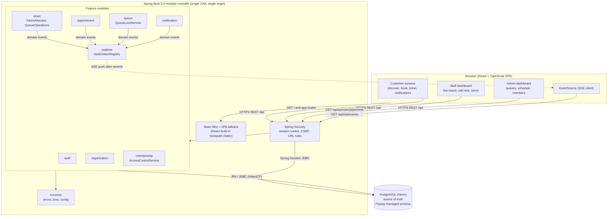
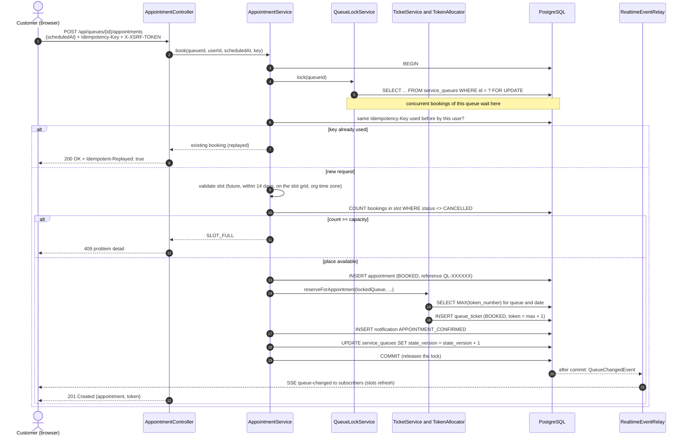
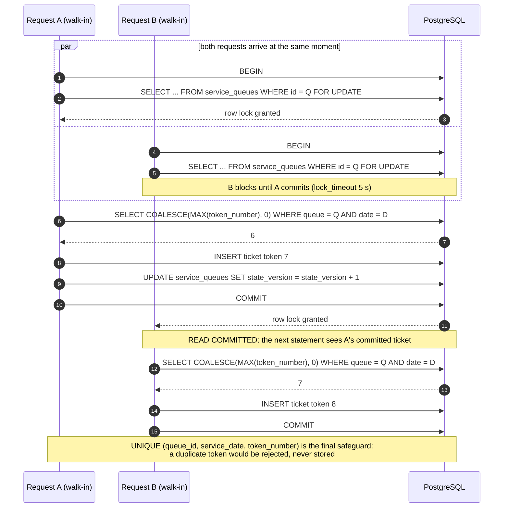
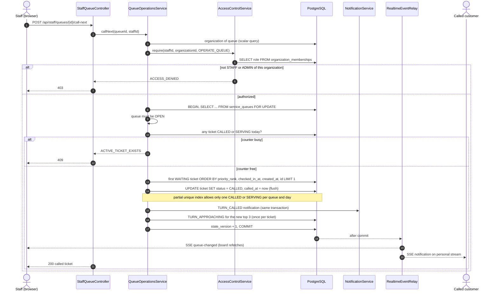
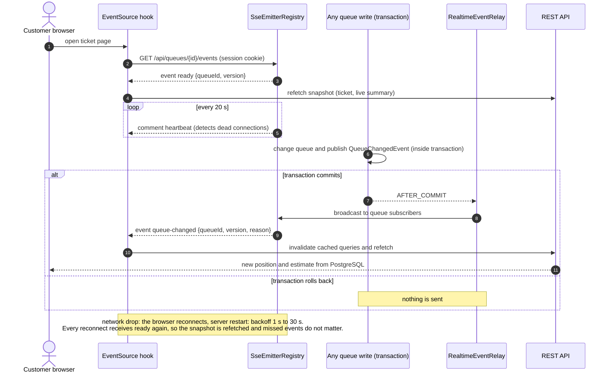
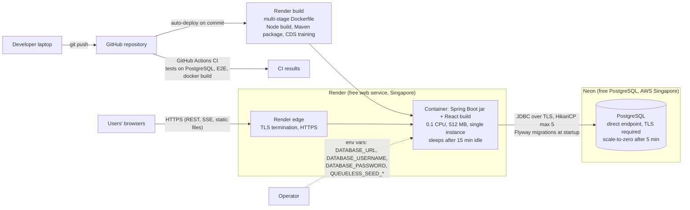
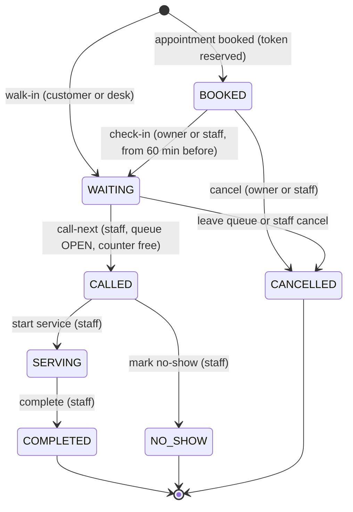

# Diagrams

Editable Mermaid sources live next to this file (`*.mmd`). GitHub renders the blocks below.
To regenerate this page after editing a source, copy the file content into its block.

## High-level system architecture

Browser, Spring Boot modular monolith and PostgreSQL. One origin serves the React build, the REST API and the SSE streams.

Source: [`01-system-architecture.mmd`](01-system-architecture.mmd)

## Database entity-relationship diagram

Tables created by the Flyway migrations V1-V3 (Spring Session tables from V4 omitted). See database-design.md for every constraint and index.

Source: [`02-entity-relationship.mmd`](02-entity-relationship.mmd)

```mermaid
erDiagram
    USERS ||--o{ ORGANIZATION_MEMBERSHIPS : "has"
    ORGANIZATIONS ||--o{ ORGANIZATION_MEMBERSHIPS : "grants"
    ORGANIZATIONS ||--o{ SERVICE_QUEUES : "runs"
    SERVICE_QUEUES ||--o{ APPOINTMENTS : "books"
    USERS ||--o{ APPOINTMENTS : "makes"
    SERVICE_QUEUES ||--o{ QUEUE_TICKETS : "issues"
    USERS |o--o{ QUEUE_TICKETS : "holds (null for guests)"
    APPOINTMENTS |o--o| QUEUE_TICKETS : "reserves exactly one"
    USERS ||--o{ NOTIFICATIONS : "receives"
    QUEUE_TICKETS |o--o{ NOTIFICATIONS : "about"

    USERS {
        uuid id PK
        varchar email UK "normalized lower-case"
        varchar full_name
        varchar password_hash "bcrypt, never returned"
        boolean enabled
        boolean platform_admin
        timestamptz created_at
        timestamptz updated_at
    }
    ORGANIZATIONS {
        uuid id PK
        varchar name
        varchar slug UK
        varchar description
        varchar timezone "IANA zone, fixed"
        boolean active
        timestamptz created_at
        timestamptz updated_at
    }
    ORGANIZATION_MEMBERSHIPS {
        uuid id PK
        uuid organization_id FK
        uuid user_id FK
        varchar role "CUSTOMER STAFF ADMIN"
        timestamptz created_at
        timestamptz updated_at
    }
    SERVICE_QUEUES {
        uuid id PK
        uuid organization_id FK
        varchar name "unique per organization"
        varchar token_prefix
        varchar status "OPEN PAUSED CLOSED"
        boolean booking_enabled
        time opening_time
        time closing_time
        int slot_duration_minutes
        int capacity_per_slot
        int default_service_minutes
        bigint state_version
    }
    APPOINTMENTS {
        uuid id PK
        uuid queue_id FK
        uuid user_id FK
        timestamptz scheduled_at
        date service_date
        varchar booking_reference UK
        varchar status
        uuid idempotency_key "unique per user"
        timestamptz cancelled_at
        uuid cancelled_by_user_id FK
    }
    QUEUE_TICKETS {
        uuid id PK
        uuid queue_id FK
        uuid user_id FK
        varchar guest_name
        uuid appointment_id FK "unique, same queue"
        varchar source
        date service_date
        int token_number "unique per queue and date"
        varchar status
        varchar priority
        smallint priority_rank "generated"
        timestamptz checked_in_at
        timestamptz called_at
        timestamptz service_started_at
        timestamptz completed_at
        timestamptz approach_notified_at
    }
    NOTIFICATIONS {
        uuid id PK
        uuid user_id FK
        uuid ticket_id FK
        varchar type
        varchar title
        varchar message
        timestamptz read_at
        timestamptz created_at
    }
```

## Appointment booking

Capacity check, insert and token reservation happen inside one transaction that holds the queue row lock.

Source: [`03-appointment-booking-sequence.mmd`](03-appointment-booking-sequence.mmd)

## Concurrent token generation

Two walk-ins arriving at the same instant are serialized by the queue row lock and receive consecutive tokens.

Source: [`04-token-generation-sequence.mmd`](04-token-generation-sequence.mmd)

## Staff call-next

Authorization against the queue's organization, then the locked transaction that calls exactly one ticket.

Source: [`05-call-next-sequence.mmd`](05-call-next-sequence.mmd)

## Live queue update (SSE)

Events are published only after commit and only carry ids; browsers refetch authorized snapshots.

Source: [`06-live-update-sequence.mmd`](06-live-update-sequence.mmd)

## Deployment architecture

GitHub, CI, Render free web service (Docker) and Neon free PostgreSQL.

Source: [`07-deployment-architecture.mmd`](07-deployment-architecture.mmd)

## Ticket state machine

Enforced by TicketStatus in Java and by CHECK constraints in PostgreSQL.

Source: [`08-ticket-state-machine.mmd`](08-ticket-state-machine.mmd)

