# Diagrams

Editable Mermaid sources live next to this file (`*.mmd`), with a PNG of each in [`png/`](png/)
for slides and documents. GitHub renders the blocks below. After editing a source, run
`node scripts/render-diagrams.mjs` to refresh this page and the PNGs (the one-time setup is at the
top of that script).

## High-level system architecture

Browser, Spring Boot modular monolith and PostgreSQL. One origin serves the React build, the REST API and the SSE streams.

Source: [`01-system-architecture.mmd`](01-system-architecture.mmd) · PNG: [`png/01-system-architecture.png`](png/01-system-architecture.png)

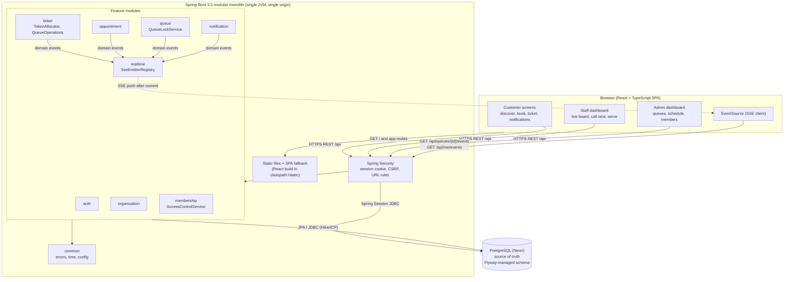

## Database entity-relationship diagram

Tables created by the Flyway migrations V1-V3 (Spring Session tables from V4 omitted). See database-design.md for every constraint and index.

Source: [`02-entity-relationship.mmd`](02-entity-relationship.mmd) · PNG: [`png/02-entity-relationship.png`](png/02-entity-relationship.png)

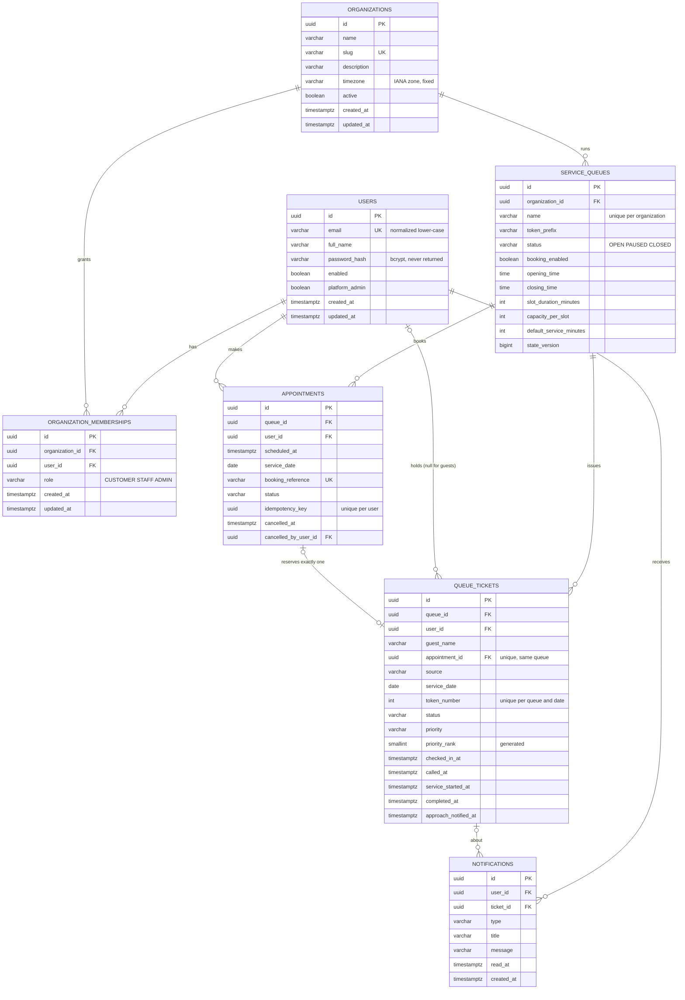

## Appointment booking

Capacity check, insert and token reservation happen inside one transaction that holds the queue row lock.

Source: [`03-appointment-booking-sequence.mmd`](03-appointment-booking-sequence.mmd) · PNG: [`png/03-appointment-booking-sequence.png`](png/03-appointment-booking-sequence.png)

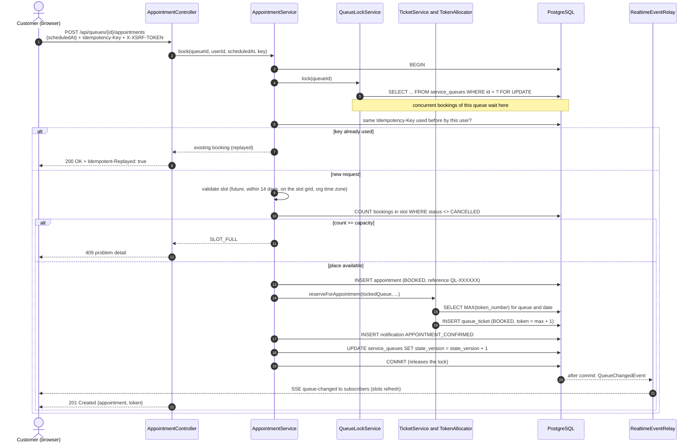

## Concurrent token generation

Two walk-ins arriving at the same instant are serialized by the queue row lock and receive consecutive tokens.

Source: [`04-token-generation-sequence.mmd`](04-token-generation-sequence.mmd) · PNG: [`png/04-token-generation-sequence.png`](png/04-token-generation-sequence.png)

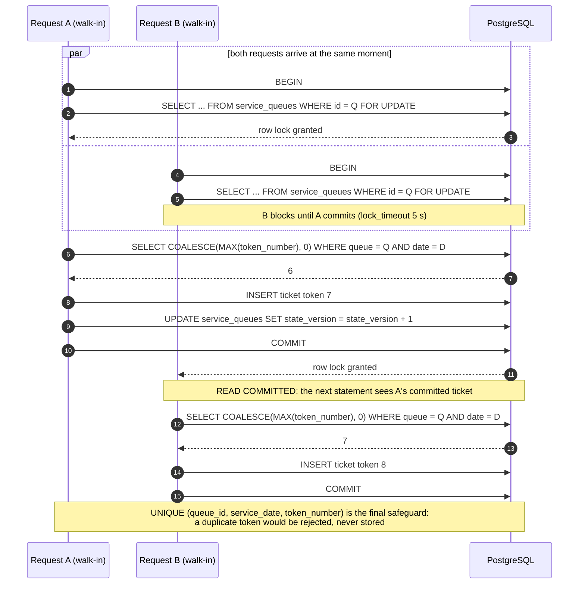

## Staff call-next

Authorization against the queue's organization, then the locked transaction that calls exactly one ticket.

Source: [`05-call-next-sequence.mmd`](05-call-next-sequence.mmd) · PNG: [`png/05-call-next-sequence.png`](png/05-call-next-sequence.png)

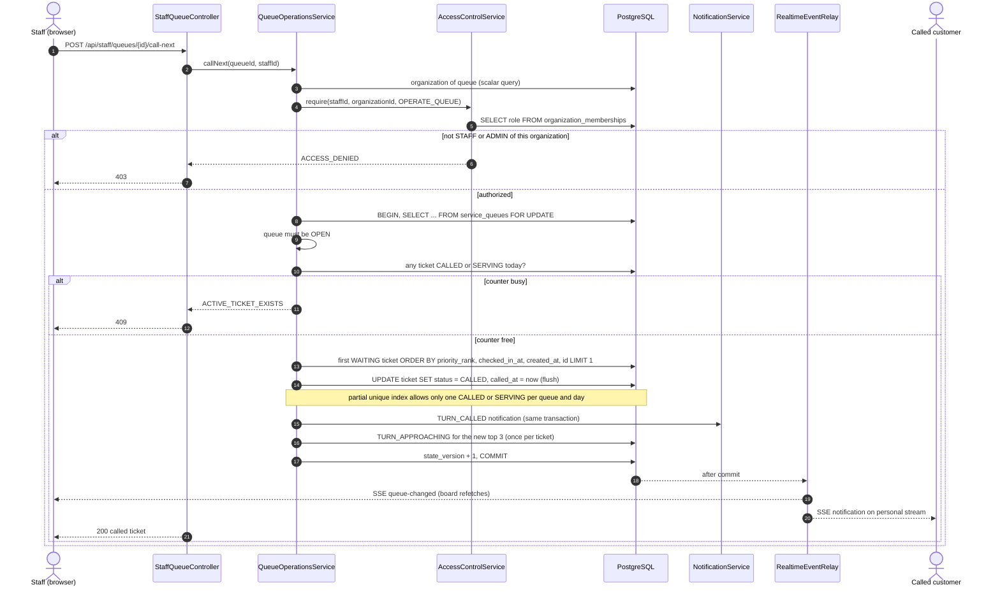

## Live queue update (SSE)

Events are published only after commit and only carry ids; browsers refetch authorized snapshots.

Source: [`06-live-update-sequence.mmd`](06-live-update-sequence.mmd) · PNG: [`png/06-live-update-sequence.png`](png/06-live-update-sequence.png)

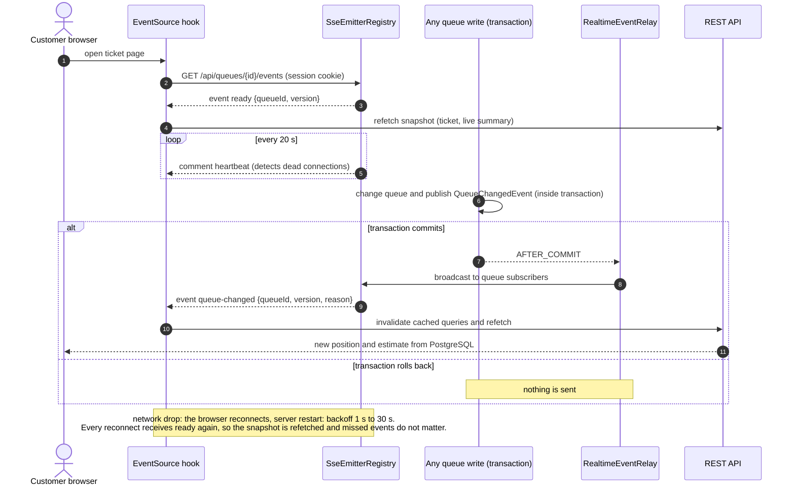

## Deployment architecture

GitHub, Render and Neon. Render builds the `Dockerfile` into one container that serves the React build, the REST API and the live updates; Neon hosts PostgreSQL. Both are free plans.

Source: [`07-deployment-architecture.mmd`](07-deployment-architecture.mmd) · PNG: [`png/07-deployment-architecture.png`](png/07-deployment-architecture.png)

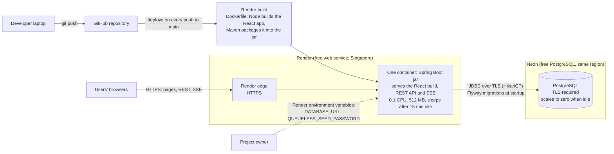

## Ticket state machine

Enforced by TicketStatus in Java and by CHECK constraints in PostgreSQL.

Source: [`08-ticket-state-machine.mmd`](08-ticket-state-machine.mmd) · PNG: [`png/08-ticket-state-machine.png`](png/08-ticket-state-machine.png)

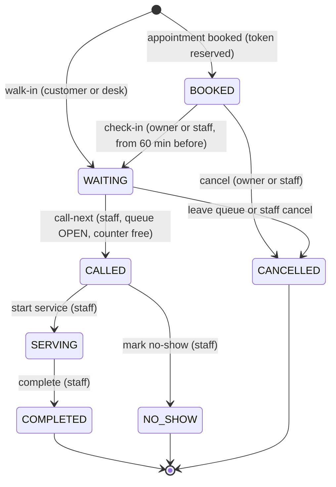

## Use case diagram

What each kind of user can do. An organization admin can also do everything staff can. A walk-in visitor without an account is registered by staff.

Source: [`09-use-case.mmd`](09-use-case.mmd) · PNG: [`png/09-use-case.png`](png/09-use-case.png)

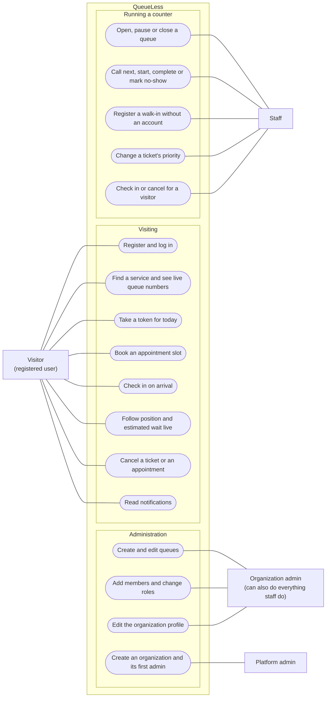

## Data flow diagram, level 0 (context)

QueueLess as a single process and the four kinds of users that exchange data with it.

Source: [`10-dfd-level-0.mmd`](10-dfd-level-0.mmd) · PNG: [`png/10-dfd-level-0.png`](png/10-dfd-level-0.png)

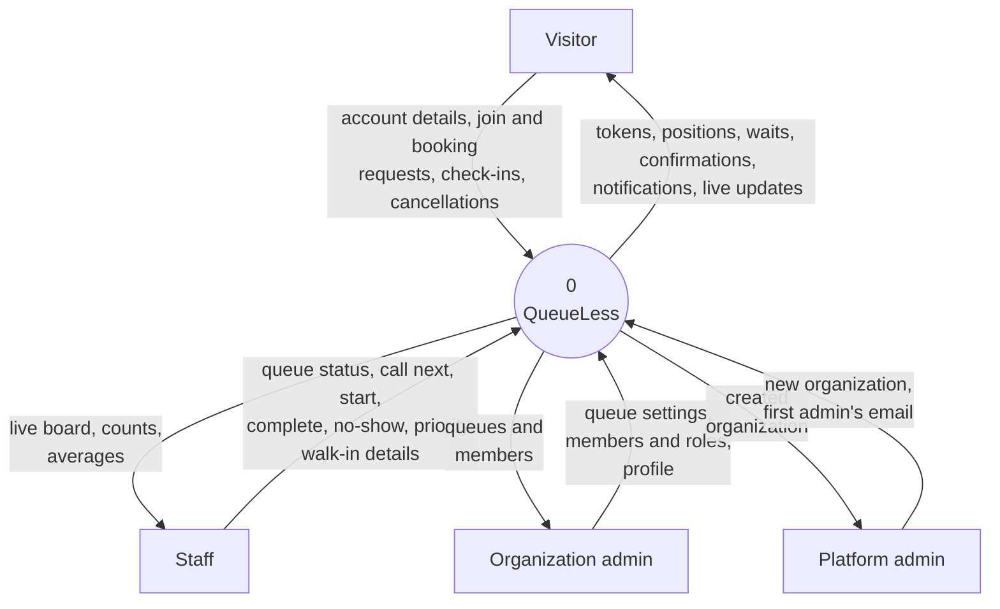

## Data flow diagram, level 1

The main processes inside QueueLess, the data stores they read and write (D1 to D6 are groups of database tables) and the flows between them. Change events reach process 7.0 only after the database transaction commits.

Source: [`11-dfd-level-1.mmd`](11-dfd-level-1.mmd) · PNG: [`png/11-dfd-level-1.png`](png/11-dfd-level-1.png)

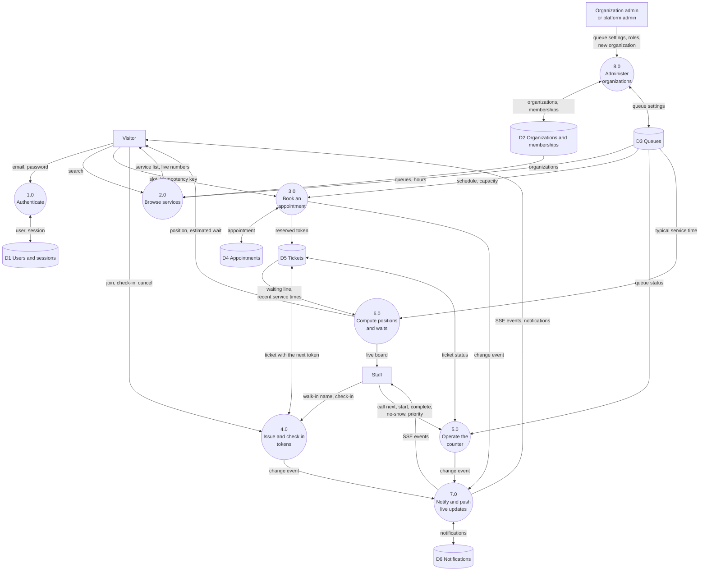

## Class diagram: domain model

The JPA entities and their enums. In the code the associations are id columns (for example `QueueTicket.queueId`), not object references; the multiplicities follow the foreign keys and unique constraints.

Source: [`12-class-domain-model.mmd`](12-class-domain-model.mmd) · PNG: [`png/12-class-domain-model.png`](png/12-class-domain-model.png)

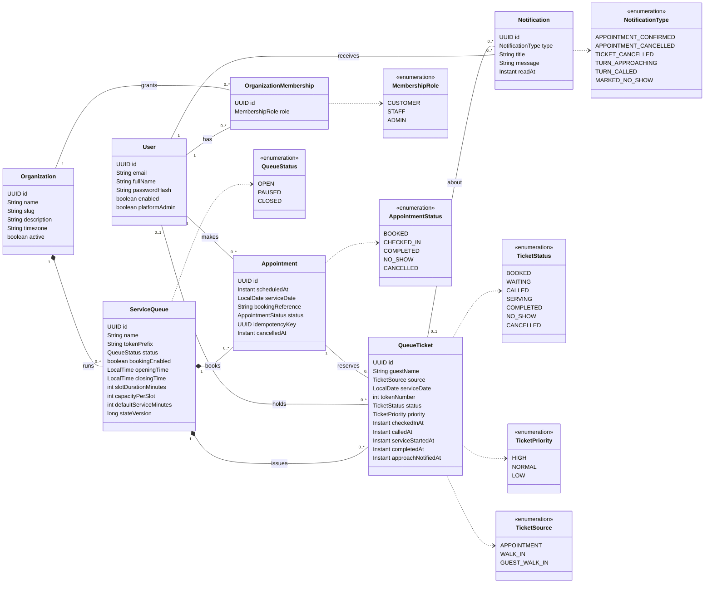

## Class diagram: service layer

The services behind the API and how they depend on each other. `LockedQueue` has a package-private constructor and is created only by `QueueLockService.lock`, so a method that takes one can rely on the queue row being locked. Events go to `RealtimeEventRelay`, which sends SSE messages only after commit.

Source: [`13-class-services.mmd`](13-class-services.mmd) · PNG: [`png/13-class-services.png`](png/13-class-services.png)

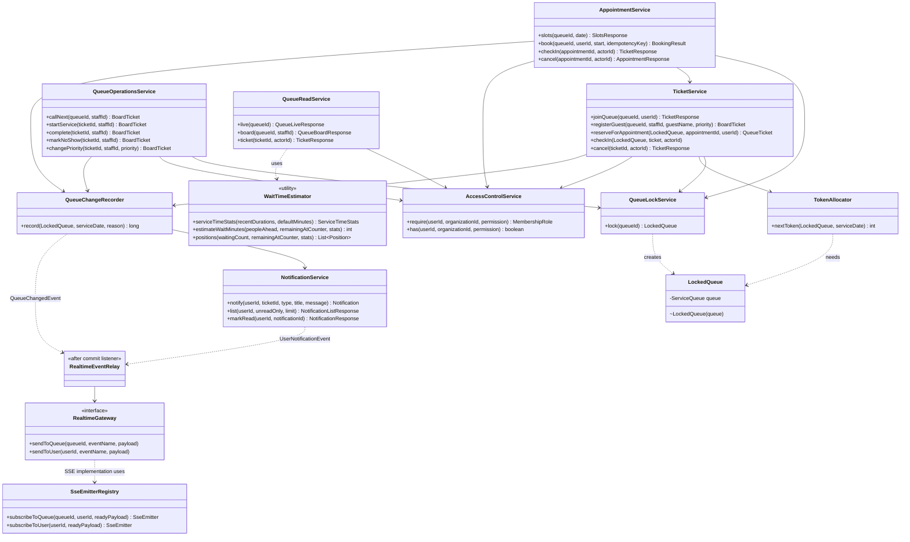

## Activity diagram: one visit

A visitor's path from walking in or booking to being served, with the cancel, no-show and expiry exits. The states match the ticket state machine above.

Source: [`14-activity-visit.mmd`](14-activity-visit.mmd) · PNG: [`png/14-activity-visit.png`](png/14-activity-visit.png)

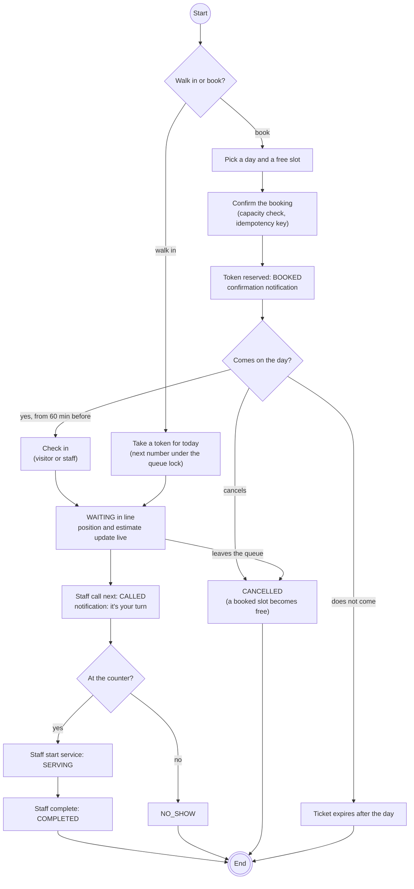
