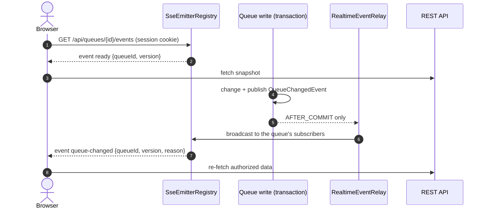

# Real-time design (Server-Sent Events)

Queue screens update without a page refresh: positions move, "now serving" changes, staff
boards refresh, and customers get a toast when their turn approaches or they are called.

## Why SSE (ADR 0004)

Updates flow one way (server → browser). SSE is plain HTTP: it uses the same session cookie
and origin as the API (no extra authentication handshake), passes through proxies, and the
browser's `EventSource` reconnects automatically. WebSockets would add a second protocol for a
bidirectional channel the app does not need; polling would either be slow or wasteful.

## Endpoints

| Stream | Authorization | Purpose |
|---|---|---|
| `GET /api/queues/{queueId}/events` | logged-in user; the queue must exist in an active organization | queue screens: customer ticket/queue pages, staff board, booking page |
| `GET /api/me/events` | logged-in user; only their own events | notification toasts and unread badge on every page |

Queue streams are open to any logged-in user because their events carry **no private data**
(only `{queueId, version, reason, occurredAt}`, the same information the public `/live` endpoint
exposes). Private details are fetched with authorized REST calls after an event: the staff board
requires STAFF in the queue's organization; a ticket is visible only to its holder and that
organization's staff. A subscriber from another organization learns nothing beyond "queue X
changed", which is already public.

## Event types

| Event | Data | Sent when |
|---|---|---|
| `ready` | `{queueId, version}` or `{userId, unreadCount}` | first event of every (re)connection |
| `queue-changed` | `{queueId, version, reason, occurredAt}` | after the commit of any change to the queue (`reason`: TICKET_CREATED, TICKET_CALLED, APPOINTMENT_BOOKED, QUEUE_STATUS_CHANGED, ...) |
| `notification` | `{notificationId, type, ticketId}` | after the commit of a stored notification for this user |
| comment `:heartbeat` | — | every 20 s on every stream |

`version` is `service_queues.state_version`, incremented under the queue lock on every change.
Clients can tell which state is newer; the current client simply re-fetches on every event.

## Server lifecycle (`SseEmitterRegistry`)

- **Registry:** `ConcurrentHashMap<queueId, Set<Subscription>>` and one map keyed by user id.
  Adding and removing a subscription happen inside `ConcurrentHashMap.compute`, so a
  subscription can never be added to a set that a concurrent removal is detaching.
- **Subscription identity:** a class with identity equality. (An earlier version used a Java
  record that contained the map it belonged to; the record's generated `hashCode()` recursed into
  the map and overflowed the stack. `RealtimeIT` caught it.)
- **Cleanup:** on completion, timeout (30 minutes; the browser then reconnects), error, or any
  failed write. `closedConnectionsAreRemovedFromTheRegistry` verifies that a closed browser is
  removed by the next heartbeat.
- **Heartbeats:** a comment every 20 s detects dead connections and keeps proxies from closing
  idle streams.
- **Writes:** one dedicated `sse-sender` thread performs all writes, so a slow client never
  blocks a request thread and events reach each connection in publication order.
- **Limits:** at most 10 open streams per user (`429` beyond) to bound resources.
- **Shutdown:** the registry is a `SmartLifecycle` that completes all streams before the web
  server's graceful shutdown, so browsers reconnect to the new instance during a redeploy.
- **Headers:** `Cache-Control: no-cache` and `X-Accel-Buffering: no` so proxies do not buffer.

## Publishing after commit

Services publish `QueueChangedEvent` and `UserNotificationEvent` as Spring application events
inside their transaction. `RealtimeEventRelay` handles them with
`@TransactionalEventListener(phase = AFTER_COMMIT)` and hands them to the `RealtimeGateway`
transport. A rolled-back transaction therefore sends nothing (tested by
`ConcurrencyIT.aRolledBackTransactionPublishesNothing`, and by the call-next test counting exactly
one event per successful call). Notifications themselves are PostgreSQL rows written in the same
transaction; the SSE message is only a nudge to fetch them.

## Client behaviour (`frontend/src/realtime`)

- `useEventStream` wraps the native `EventSource`.
- On every `ready` (initial connect **and** every reconnect) it calls `onReady`, which
  invalidates the relevant TanStack Query caches, so the screen shows a fresh snapshot. This is
  what makes missed events harmless.
- On `queue-changed` it invalidates `['queue', id]` (configuration, live summary, slots, board),
  tickets, appointments and "my" data; TanStack Query re-fetches what is on screen.
- Network blips: the browser reconnects by itself (`retry: 3000` suggested by the server).
  If the browser gives up (HTTP error, e.g. during a restart or after the session expired), the
  hook reconnects with exponential backoff (1 s → 30 s, with jitter), re-checks the session, and
  reconnects immediately when the browser comes back online.
- A visible **Live / Reconnecting** indicator tells users whether updates are flowing; the page
  always shows the last fetched snapshot.

## Design limitation: single instance (ADR 0005)

The registry and immediate delivery live in one JVM. With two application instances, a change
committed on instance A would only reach browsers connected to A. A multi-instance deployment
needs a shared distribution channel:

1. Each instance subscribes to a channel: **PostgreSQL `LISTEN/NOTIFY`** (no new infrastructure;
   needs a dedicated non-pooled connection per instance; payload ≤ 8 KB, fine for ids) or **Redis
   Pub/Sub** (more throughput, extra service).
2. `RealtimeEventRelay` (still AFTER_COMMIT) publishes to the channel through a new
   `RealtimeGateway` implementation instead of writing to local emitters.
3. Every instance forwards channel messages to its own local `SseEmitterRegistry`.

Business code does not change — it only publishes domain events. Load balancers need no sticky
sessions for correctness because clients re-fetch snapshots after reconnecting to any instance
(sessions are already shared through PostgreSQL). Redis is **not** added now because one
instance meets the requirements and the free host runs exactly one.

## Hosting notes

- Render's free instance sleeps after 15 minutes without inbound traffic; open SSE streams do
  not count as inbound traffic. When it sleeps, streams close; the next visit wakes it (about a
  minute) and the client reconnects and re-fetches.
- The heartbeat interval (20 s) is well below common proxy idle timeouts.
